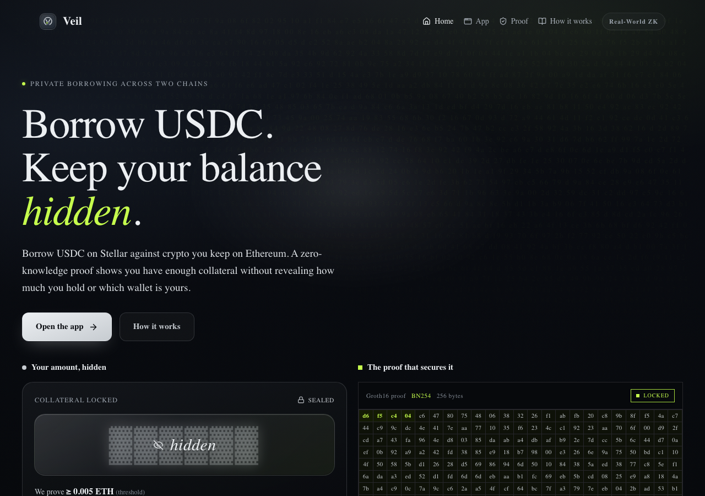
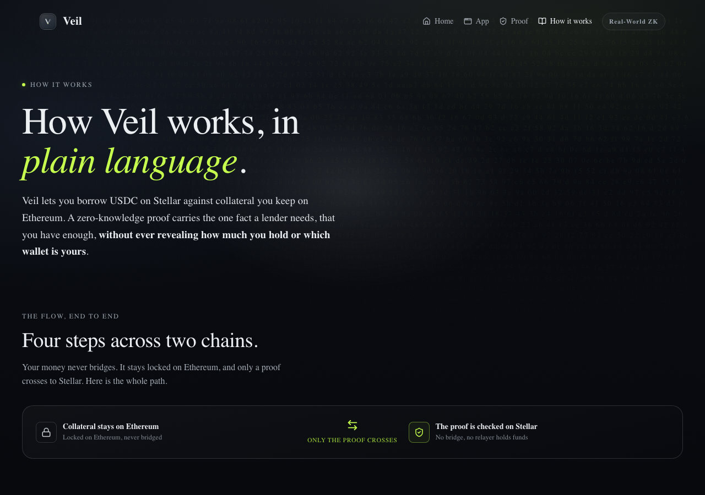
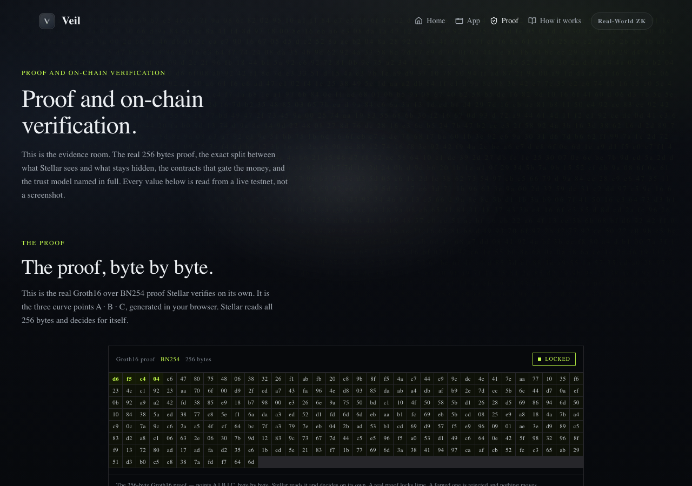

<p align="center">
  
</p>

# Veil: private cross-chain margin lending

Borrow USDC on Stellar against collateral you keep on Ethereum, with a zero-knowledge proof that hides your exact amount and your Ethereum wallet from the Stellar ledger. The collateral never bridges. Real WETH stays locked on Ethereum; only a note commitment, an amount, and a Groth16 proof cross over. What Stellar verifies is the proof, not a relayer's word. Built for Stellar Hacks: Real-World ZK.

[](https://nextjs.org/)
[](https://www.typescriptlang.org/)
[](https://soroban.stellar.org/)
[](https://docs.circom.io/)
[](LICENSE)
[]()

**Live:** [veilzk.vercel.app](https://veilzk.vercel.app)

---



## Live Demo

**[veilzk.vercel.app](https://veilzk.vercel.app)**

Connect MetaMask (Sepolia) and Freighter (Stellar testnet), lock real WETH on Ethereum, and watch a shielded note appear on Stellar. Generate the borrow proof in your browser and draw real Circle USDC against a collateral amount that never touches the Stellar ledger. The `/proof` page reads every value live from testnet, and `/how-it-works` walks the full flow.

## Demo Video

<!-- TODO: add YouTube link after recording -->
_Demo video link coming soon._

---

## What Is Veil?

Veil lets you borrow a stablecoin on one chain against collateral that stays on another, without revealing how much collateral you hold or which wallet holds it. You lock wrapped ETH on Ethereum, prove in zero knowledge that it clears a threshold, and receive USDC on Stellar. The lender, the ledger, and every observer learn only that you cleared the bar, never the figure above it.

Real WETH locked on Ethereum Sepolia. Real Circle USDC disbursed on Stellar. Both zero-knowledge proofs generated in the browser and verified on-chain. Every contract address and transaction below is live and independently verifiable.

---

## Screenshots

| How it works | Proof and verification |
|--------------|------------------------|
|  |  |

---

## Why the ZK is load-bearing

Remove the proof and the product is gone.

The borrow is gated by a Groth16 (BN254) proof whose only public inputs are `{ root, threshold, nullifier, borrower }`. The exact collateral `amount` and the note's secret opening are **private witnesses that never leave your browser**. Delete the proof and `borrow()` on Stellar would have to carry your Ethereum amount in cleartext so the contract could check tree membership itself, publishing it on the Stellar ledger permanently. Native Merkle verification cannot hide the amount; only the SNARK can.

The proof is verified **on-chain inside a Soroban contract** using Protocol 27 BN254 host functions, and only a valid proof moves real USDC. A borrow proof carrying a tampered threshold (an unproven collateral floor) returns `Error(Contract, #0) InvalidProof`, the vault traps, and **zero USDC moves**.

---

## How It Works

```
   ETHEREUM (Sepolia)                                 STELLAR (Soroban)
 ┌─────────────────────┐                          ┌──────────────────────┐
 │  Wrap ETH → WETH    │                          │                      │
 │        │            │                          │                      │
 │        ▼            │        Axelar GMP         │                      │
 │  VeilEthLock.lock ──┼──(commitment, amount)────►│  veil-pool.execute   │
 │  • escrow real WETH │   decentralized validator │  • validate_message  │
 │  • verify opening   │   set authenticates the   │  • mint shielded     │
 │    proof ON-CHAIN   │   message on the gateway  │    note (Poseidon2)  │
 │  • emit ContractCall│                          │        │              │
 └─────────────────────┘                          │        ▼              │
                                                   │  client Groth16 proof │
   collateral NEVER bridges;                       │  (in the browser)     │
   only (C, amount) + proof cross                  │        │              │
                                                   │        ▼              │
                                                   │  veil-vault.borrow    │
                                                   │  • verify proof natively │
                                                   │  • price via Reflector│
                                                   │  • disburse real USDC │
                                                   └──────────────────────┘
```

**1. Lock (Ethereum).** You wrap real ETH into canonical WETH and lock it in `VeilEthLock`, bound to a note commitment `C`. A `deposit_from_eth` Groth16 proof, verified on Ethereum, attests that `C` opens to `(amount, spend key, blinding)`. The contract emits an Axelar `ContractCall` carrying `(C, amount)`.

**2. Cross (Axelar).** Axelar's decentralized validator set carries the message to Stellar. The Soroban pool's `execute` authenticates it through the Axelar gateway's `validate_message`. No trusted relayer, no state-root poster. The pool mints an AVAILABLE shielded note as a leaf in a Poseidon2 Merkle tree.

**3. Borrow (Stellar).** Your browser builds a Groth16 proof that the note is in the pool tree and its hidden amount clears the public threshold, bound to your Stellar account so the proof cannot be stolen. The `veil-vault` verifies it natively on-chain, sizes the loan from the live Reflector ETH/USDC price at the configured LTV, and disburses real Circle USDC.

**4. Close the loop.** Repaying on Stellar releases a secret that unlocks your WETH back on Ethereum, where the collateral lived the whole time. No Stellar-to-Ethereum proof is ever required.

---

## Integrations

Veil composes four live systems. Each does one job, and removing any one breaks the flow.

### Circom + Groth16 on Soroban (the load-bearing ZK)

Two proofs are generated client-side with snarkjs and verified on-chain: the `deposit_from_eth` opening proof on Ethereum, and the shielded `borrow` proof on Stellar. The Soroban verifier uses Protocol 27 BN254 host functions.

```
borrow proof public inputs: { root, threshold, nullifier, borrower }
private witnesses:          { amount, spendKey, blinding, merklePath }
tampered threshold → Error(Contract, #0) InvalidProof → 0 USDC moves
```

### Axelar General Message Passing (trust-minimized cross-chain)

`VeilEthLock` emits an Axelar `ContractCall` at lock time; the Soroban pool authenticates delivery via the gateway's `validate_message`. A forged `execute` with a fake message id traps with `Error(Storage, MissingValue)` because the gateway holds no such approved message.

```solidity
// VeilEthLock.lock: after escrowing WETH and verifying the opening proof
gateway.callContract(destinationChain, destinationContract, abi.encode(C, amount));
```

### Reflector oracle (collateral pricing)

The vault reads the live ETH/USDC price from Reflector to size each loan at the configured LTV, with a staleness bound so a stale feed cannot mis-price a borrow.

### Circle USDC via the Stellar Asset Contract

Loans are disbursed in real Circle testnet USDC through its SAC. The borrow in the proof below moved 6.05 USDC on-chain.

---

## Tech Stack

| Layer | Technology |
|-------|-----------|
| ZK | Circom circuits, Groth16 over BN254, snarkjs (browser proving), Poseidon2 |
| Stellar | Soroban (soroban-sdk, Protocol 27), native BN254 host functions, Reflector oracle, Circle USDC SAC |
| Ethereum | Solidity + Foundry, canonical WETH, snarkjs Groth16 verifier |
| Cross-chain | Axelar General Message Passing (gateway + gas service) |
| App | Next.js 15 (App Router), React 19, TypeScript, `@stellar/stellar-sdk` + `viem`, MetaMask + Freighter |

---

## Testing

```bash
cd contracts/escrow     && forge test    # 68 passing (VeilEthLock + verifiers)
cd contracts/veil-pool  && cargo test    # 39 passing (Axelar execute, note tree)
cd contracts/veil-vault && cargo test    # 21 passing (borrow, margin, LP)
cd web                  && pnpm test     # 103 passing (provers, tree, crosschain)
# Total: 231 passing
```

The contract suites cover the on-chain proof verification, the cross-chain injection gate, tree reconstruction, and loan sizing. The web suite proves the client-side Groth16 provers produce proofs that verify against the deployed verifiers.

You can also run the browser provers against the live on-chain verifiers:

```bash
cd web && pnpm verify:prover        # borrow proof verifies on-chain
cd web && pnpm verify:lock-prover   # lock proof verifies on-chain
```

---

## Try It (5 minutes)

1. Go to **[veilzk.vercel.app](https://veilzk.vercel.app)** and open `/app`.
2. Connect **MetaMask** on Ethereum Sepolia and **Freighter** on Stellar testnet.
3. Wrap a small amount of Sepolia ETH into WETH and **lock** it. The lock verifies an opening proof on Ethereum and fires an Axelar message.
4. Wait for Axelar to deliver the attestation to Stellar (the UI tracks the hops). Your shielded note appears in the pool.
5. Click **Borrow**. Your browser generates the Groth16 proof, the Soroban vault verifies it, and real USDC lands in your Stellar wallet. The amount you locked never appears on the Stellar ledger.

### Network Setup

| Network | Chain ID | RPC |
|---------|----------|-----|
| Ethereum Sepolia | 11155111 | `https://ethereum-sepolia-rpc.publicnode.com` |
| Stellar testnet | n/a | `https://soroban-testnet.stellar.org` |

Get Sepolia ETH from a [Sepolia faucet](https://sepoliafaucet.com/) and testnet USDC from the [Circle faucet](https://faucet.circle.com/).

---

## Smart Contracts

| Contract | Network | Address |
|----------|---------|---------|
| VeilEthLock | Ethereum Sepolia | [`0x06bB519A490030DE251EeB83818F875Cc87002e0`](https://sepolia.etherscan.io/address/0x06bB519A490030DE251EeB83818F875Cc87002e0) |
| veil-pool | Stellar Soroban | [`CA7H5WQISBIWVEWXRBTGHSB3UMEFK7RR4QJHYGAMZVEV7NSW3MFJLHLN`](https://stellar.expert/explorer/testnet/contract/CA7H5WQISBIWVEWXRBTGHSB3UMEFK7RR4QJHYGAMZVEV7NSW3MFJLHLN) |
| veil-vault | Stellar Soroban | [`CAXOQQ7V4ZDI5TO5SJQQLGXHMWATL3VXXG5YBZJ33SCR7IJ3C7JRYBPT`](https://stellar.expert/explorer/testnet/contract/CAXOQQ7V4ZDI5TO5SJQQLGXHMWATL3VXXG5YBZJ33SCR7IJ3C7JRYBPT) |
| Groth16 borrow verifier | Stellar Soroban | [`CBTSWUY5OME4EDY3YA7OBRXHVMSBZH4MWO4GSGNPR4FAGG36RGQGDMM2`](https://stellar.expert/explorer/testnet/contract/CBTSWUY5OME4EDY3YA7OBRXHVMSBZH4MWO4GSGNPR4FAGG36RGQGDMM2) |

---

## On-Chain Verification

The full forward flow, proven live and independently verifiable:

| Step | Link |
|------|------|
| Real WETH lock (Ethereum, block 11194551) | [`0x4fa09246…b77cc959`](https://sepolia.etherscan.io/tx/0x4fa09246a74fb6463c49b35fd3233459a0984a0ad53349603be3868db77cc959) |
| Axelar delivery → Stellar | [`bdc2af52…c9a40fe27`](https://stellar.expert/explorer/testnet/tx/bdc2af52b1382a375bcc73dd05b42929de777e66b44c928a1a6af91c9a40fe27) |
| Borrow → 6.05 USDC disbursed (Stellar) | [`3a3bb9b5…044cd8a3`](https://stellar.expert/explorer/testnet/tx/3a3bb9b53b1f40f687b9c8bff5606dd1642a9cf3896243cc02bdcd1c044cd8a3) |

Both Groth16 proofs were generated in the browser and verified on-chain: the opening proof inside `VeilEthLock.lock` on Ethereum, and the borrow proof inside `veil-vault.borrow` on Stellar.

---

## Running Locally

```bash
git clone https://github.com/dmustapha/veil.git
cd veil

# App (live testnet reads, no keys needed)
cd web && pnpm install && pnpm dev      # http://localhost:3000

# Ethereum contracts
cd contracts/escrow && forge test

# Soroban contracts
cd contracts/veil-pool && cargo test
cd contracts/veil-vault && cargo test
```

### Required Environment Variables

The hosted app runs entirely on public testnet reads and needs no secrets. For local proof generation and admin scripts, see `web/.env.example`.

| Variable | Description |
|----------|-------------|
| `NEXT_PUBLIC_SEPOLIA_RPC` | Optional Sepolia read RPC override (defaults to publicnode) |

---

## Project Structure

```
contracts/escrow      Sepolia WETH lock + opening-proof verifier (Foundry)
contracts/veil-pool   Soroban shielded note pool, Axelar execute (soroban-sdk)
contracts/veil-vault  Soroban lending vault: borrow, margin, LP (soroban-sdk)
circom                Circom circuits: deposit_from_eth, lock, borrow, release
web                   Next.js client (/, /app, /proof, /how-it-works) + browser provers
relayer               Axelar gas + delivery helpers
DEPLOYMENTS.md        every deployed address + on-chain wiring
```

---

Built for [Stellar Hacks: Real-World ZK](https://dorahacks.io/) (Stellar Development Foundation).

## License

MIT. See [LICENSE](LICENSE).
